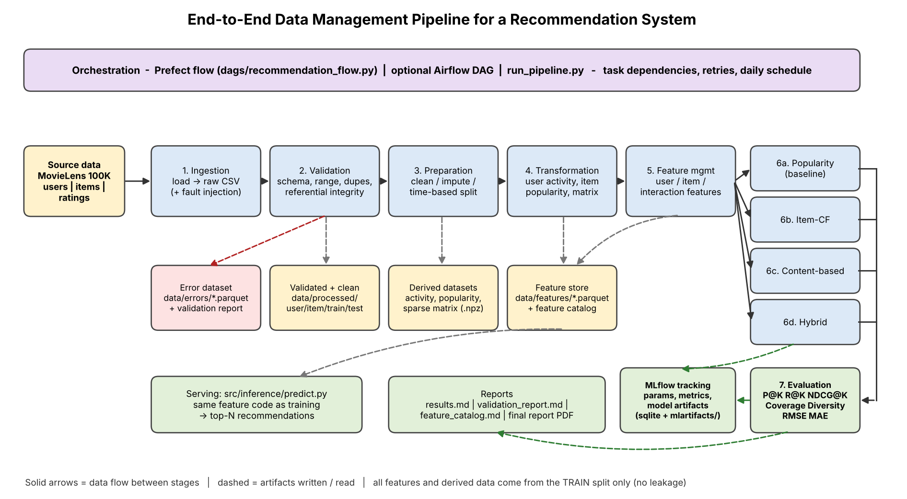

# End-to-End Data Management Pipeline for a Recommendation System

Data Management for Machine Learning (AIMLZG529) - Assignment 2.

This repository implements a complete, reproducible data pipeline for a movie recommender. It takes raw user, item and rating
data and carries it through every stage of the lifecycle:

`Ingestion -> Validation -> Preparation -> Transformation -> Feature Management -> Model Training -> Model Evaluation -> Orchestration`

This README is the **process document**: it explains what each stage does, why, how to run it and how to verify it.

| Read this | For |
|---|---|
| [`reports/evidence.md`](reports/evidence.md) | Screenshots and outputs proving every stage ran (stage images, Prefect UI, MLflow UI) |
| [`reports/feature_catalog.md`](reports/feature_catalog.md) | Every feature: entity, type, definition, computation |
| [`reports/model_comparison.md`](reports/model_comparison.md) | Baseline vs personalised models: setup, results table, interpretation |
| [`reports/validation_report.md`](reports/validation_report.md) | Data-quality checks, rejected rows, injected-vs-detected faults |
| [`reports/final_report.pdf`](reports/final_report.pdf) | The short written report (design decisions, tools, results, limitations) |



## 1. At a glance

* **Data:** [MovieLens 100K](https://grouplens.org/datasets/movielens/100k/) - 943 users, 1,682 movies, 100,000 ratings (1-5 stars). A copy is bundled in `data/raw/ml-100k/`, so the pipeline runs offline (if missing, ingestion downloads it).
* **Task:** recommend the top-10 movies a user has not rated yet; a rating of 4 or more counts as a "like".
* **Models:** popularity baseline, item-based collaborative filtering, content-based (genre profile), and a hybrid of the last two.
* **Metrics:** Precision@10, Recall@10, NDCG@10, Coverage, Diversity, plus RMSE / MAE for rating prediction.
* **Tooling:** Python, pandas, SciPy, Parquet storage, a custom feature layer, MLflow (experiment tracking), Prefect (orchestration), pytest.
* **Reproducible:** one config file (`configs/config.yaml`), fixed seed, pinned `requirements.txt`; two runs give identical numbers.

## 2. Setup and execution

Python 3.11 or newer is required (tested on 3.12; works in WSL/Ubuntu).

```bash
git clone https://github.com/2025ag05218/recommendation-pipeline.git && cd recommendation-pipeline
python3 -m venv .venv && source .venv/bin/activate      # Windows: .venv\Scripts\activate
pip install -r requirements.txt
```

Run the whole pipeline - pick **one** of these equivalent options (they call the same stage code, about 10 seconds in total):

```bash
python dags/recommendation_flow.py        # Prefect flow (orchestrated, parallel training tasks)
python run_pipeline.py                    # plain Python runner, no orchestrator
python run_pipeline.py --stage features   # a single stage, e.g. for debugging
```

Check and explore the results:

```bash
python -m pytest -q                                            # 8 unit tests
python -m src.inference.predict --user 42 --k 10 --model hybrid
mlflow ui --backend-store-uri sqlite:///mlflow.db              # experiment tracking UI -> http://127.0.0.1:5000
```

**Prefect UI** (for the orchestration screenshot): in one terminal run `prefect server start`; in a second terminal run
`export PREFECT_API_URL=http://127.0.0.1:4200/api` and then `python dags/recommendation_flow.py`; open http://127.0.0.1:4200 -> *Runs*.
`mlflow ui` and `prefect server start` each keep their terminal busy, so use a separate terminal for each.

**Regenerate documents and evidence** (after a run): `python scripts/make_stage_screenshots.py`, `python scripts/make_docs.py`,
`python scripts/make_report.py --repo-url <your-github-url> [--with-evidence]`.

## 3. The process, stage by stage

Every stage is a Python module under `src/`, reads its input from `data/` and the config, writes its output back to `data/` or `reports/`,
and logs to `reports/pipeline.log`. Stages only communicate through files, which is what makes them re-runnable one at a time.

### Stage 1 - Data ingestion (`src/ingestion/ingest.py`)
* **Purpose:** bring raw user, item and interaction data into the pipeline.
* **How:** reads `u.user`, `u.item`, `u.data` and writes three **untyped text CSVs** (`data/raw/csv/`), like data arriving from an external system.
* **Fault injection:** MovieLens is almost perfectly clean, so a seeded, documented step (`ingestion.inject_faults`, default on) corrupts or appends ~650 rows - duplicates, invalid ratings/timestamps, missing values, orphan ids. This gives the next stage real defects to find. Set it to `false` for untouched data.
* **Verify:** `reports/ingestion_summary.json`; image `reports/screenshots/stage_1_ingestion.png`.

### Stage 2 - Data validation (`src/validation/validate.py`)
* **Purpose:** stop bad data before it reaches the model.
* **Checks:** missing values, duplicate keys/rows, wrong data types, ratings outside 1-5, timestamps outside the valid window, and referential integrity (every interaction must point to an existing user and item).
* **Two severities:** **REJECT** (unusable record -> moved to `data/errors/*.parquet` with an `error_reason`) and **WARN** (usable record with a bad attribute, e.g. age 250 -> kept, counted, repaired in stage 3). The run fails if more than 20% of a table is rejected.
* **Verify:** `reports/validation_report.md` includes an *injected vs detected* table (every fault found); `reports/validation_errors_sample.csv`; image `stage_2_validation.png`.

### Stage 3 - Data preparation (`src/preparation/prepare.py`)
* **Purpose:** produce clean, consistent data and the train/test split.
* **How:** median imputation (age, release year), standardised text/case/genres, epoch -> UTC datetime, one rating per (user, item) (latest wins), users with fewer than 5 ratings dropped.
* **Time-based split:** for every user, the most recent 20% of their ratings become the test set; the rest is training. This mimics predicting the future from the past. A single global cut-off is available (`preparation.split.strategy: global`).
* **Verify:** `reports/preparation_summary.json`; `data/processed/train.parquet`, `test.parquet`; image `stage_3_preparation.png`.

### Stage 4 - Data transformation (`src/transformation/transform.py`)
* **Purpose:** derived datasets the later stages need - all computed from the **training split only**.
* **Outputs:** `user_activity_summary`, `item_popularity`, and the sparse user x item rating matrix (`interaction_matrix.npz` + `matrix_index.json`).
* **Verify:** `reports/transformation_summary.json`; image `stage_4_transformation.png`.

### Stage 5 - Feature management (`src/features/feature_store.py`)
* **Purpose:** documented, reusable features for users, items and user-item pairs (examples: average rating, activity count, days since last interaction, preferred genre, item popularity, item average rating - full list in [`reports/feature_catalog.md`](reports/feature_catalog.md)).
* **Design:** one registry documents every feature and generates the catalog; one set of compute functions is used for both training and prediction (no training/serving skew); features are **point-in-time** (`as_of` = last training timestamp) and use training data only (no leakage); `FeatureStore` saves/loads the parquet tables and serves lookups by id.
* **Verify:** `data/features/*.parquet`; image `stage_5_features.png`.

### Stage 6 - Model training (`src/training/models.py`, `train.py`)
* **Models:** (1) *Popularity* baseline; (2) *Item-CF* - item-item cosine similarity with significance shrinkage; (3) *Content-based* - cosine between the user's genre profile and the item's genres, using the stage-5 features; (4) *Hybrid* - 0.7 x CF + 0.3 x content.
* **Tracking:** each model is one MLflow run in experiment `recsys-movielens-100k` (parameters, training time, model artifact); the run id is saved in `models/<name>.run.json`.
* **Verify:** `models/*.joblib`; MLflow UI; images `stage_6_training.png`, `mlflow_*.png`.

### Stage 7 - Model evaluation (`src/evaluation/`)
* **Protocol:** for each user, rank all items they have not rated in training and take the top 10; relevant = test rating >= 4.
* **Metrics:** Precision@10, Recall@10, NDCG@10, Coverage, Diversity, and RMSE / MAE for models that predict ratings. Metrics are logged to the same MLflow runs.
* **Verify:** `reports/results.md` / `results.csv`, chart `model_comparison.png`, analysis in [`reports/model_comparison.md`](reports/model_comparison.md); image `stage_7_evaluation.png`.

### Stage 8 - Orchestration (`dags/recommendation_flow.py`)
* **Purpose:** run the stages automatically, in the right order, reproducibly.
* **How:** a Prefect flow where each stage is a task with explicit dependencies; the four training tasks run in parallel and evaluation waits for all of them; ingestion retries once; a daily schedule can be attached with `python dags/recommendation_flow.py --serve`. `run_pipeline.py` is a dependency-free equivalent, and `dags/airflow_dag.py` is an optional, untested Airflow version.
* **Verify:** `reports/prefect_run_screenshot.png` and the other Prefect images in `reports/screenshots/`; `reports/run_log.jsonl`.

## 4. Repository layout

The suggested project structure is followed exactly (`data/{raw,processed,features,errors}`, `src/<stage>/`, `dags/`, `configs/`, `models/`, `reports/`, `requirements.txt`, `README.md`). Additions beyond the suggestion are marked *(added)*.

```
recommendation-pipeline/
├── data/
│   ├── raw/            bundled MovieLens 100K (+ raw/csv written by ingestion)
│   ├── processed/      validated, clean, train/test, derived datasets, matrix
│   ├── features/       user / item / interaction feature tables
│   └── errors/         rejected records with reasons
├── src/
│   ├── ingestion/  validation/  preparation/  transformation/  features/  training/  evaluation/
│   ├── inference/      top-N recommendations using the shared feature code
│   └── common.py       config, paths, logging
├── dags/               recommendation_flow.py (Prefect), airflow_dag.py (optional)
├── configs/            config.yaml - every setting and the seed
├── models/             trained models (.joblib) and MLflow run ids
├── reports/            validation report, feature catalog, results, model comparison, evidence,
│   │                   final report PDF, plots, logs
│   └── screenshots/    stage images, Prefect and MLflow screenshots
├── docs/architecture.png
├── scripts/            diagram, workflow graphic, stage screenshots, docs, report generators
├── tests/              8 unit tests
├── run_pipeline.py     plain Python runner / single-stage CLI
├── pytest.ini  requirements.txt  README.md
```

## 5. Reproducibility and quality controls

* **One config, one seed:** all thresholds, split, model parameters, paths and MLflow settings are in `configs/config.yaml`; `seed: 42`.
* **No leakage:** the split happens before any statistic is computed; matrices, features and similarities use training data only.
* **Re-runnable stages:** each stage reads and writes files, so any stage can be run alone (`--stage`).
* **Tests:** metrics, validation checks, the time-based split and the point-in-time rule are unit-tested (`python -m pytest -q`).
* **Observability:** per-stage logs in `reports/pipeline.log`, timings in `reports/run_log.jsonl`, MLflow for parameters/metrics/artifacts.

## 6. Design decisions and limitations

* **Custom feature layer instead of Feast:** the requirement is reuse for training and prediction, which shared compute functions plus a small `FeatureStore` provide without extra infrastructure.
* **Per-user chronological split** keeps nearly every user evaluable; its drawback is that one user's test events can precede another user's training events.
* **Injected faults** demonstrate the validation stage; the reported data quality is therefore a demonstration, not a property of MovieLens.
* **Small, popular dataset:** dense score matrices are fine for 943 x 1,682; larger catalogues need sparse retrieval. No hyper-parameter tuning, single seed, offline metrics only. More in the final report.

## 7. Data licence
MovieLens 100K (c) GroupLens Research, University of Minnesota; used for education/research under the licence in `data/raw/ml-100k/README`.
