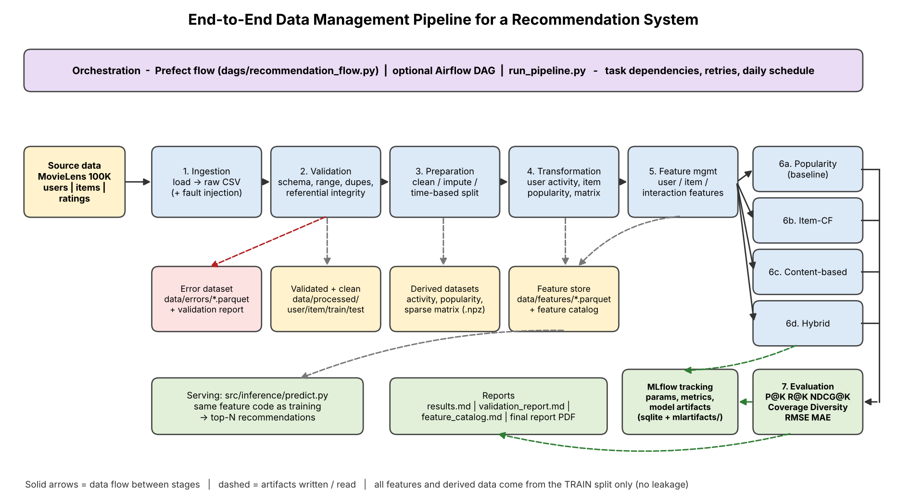

# End-to-End Data Management Pipeline for a Recommendation System

Data Management for Machine Learning (AIMLZG529) - Assignment 2.
A modular, reproducible pipeline that goes from raw data to evaluated recommenders:

`Ingestion -> Validation -> Preparation -> Transformation -> Feature Management -> Model Training -> Model Evaluation -> Orchestration`

* **Dataset:** [MovieLens 100K](https://grouplens.org/datasets/movielens/100k/) (943 users, 1,682 movies, 100,000 ratings). A copy is bundled in `data/raw/ml-100k/` so the pipeline runs **offline**; if it is missing, ingestion downloads it.
* **Models:** popularity baseline, item-based collaborative filtering, content-based (genre profile) and a hybrid of CF + content.
* **Tracking:** MLflow (SQLite backend). **Orchestration:** Prefect flow (+ optional Airflow DAG + plain Python runner).
* **Metrics:** Precision@10, Recall@10, NDCG@10, Coverage, Diversity, plus RMSE / MAE for rating prediction.



## 1. Setup

```bash
git clone <your-repo-url> recommendation-pipeline && cd recommendation-pipeline
python3 -m venv .venv && source .venv/bin/activate      # Windows: .venv\Scripts\activate
pip install -r requirements.txt
```
Python 3.11+ is required (tested on 3.12).

## 2. Run the whole pipeline

Pick **one** of the three equivalent ways (they call the same stage code):

```bash
python dags/recommendation_flow.py     # Prefect flow (recommended; this is the orchestrated run)
python run_pipeline.py                 # plain Python runner, no orchestrator
python run_pipeline.py --stage features   # a single stage, e.g. for debugging
```
A full run takes about 10 seconds. It is deterministic (`seed: 42`, fixed config), so re-running gives the same numbers.

Then:
```bash
pytest -q                                                   # 8 unit tests (metrics, validation, split)
python -m src.inference.predict --user 42 --k 10 --model hybrid   # top-10 recommendations for a user
mlflow ui --backend-store-uri sqlite:///mlflow.db           # compare runs at http://127.0.0.1:5000
python scripts/make_architecture_diagram.py                 # regenerate docs/architecture.png
python scripts/make_workflow_graphic.py                     # regenerate reports/workflow_run.png
python scripts/make_report.py                               # regenerate reports/final_report.pdf from latest results
```

### Orchestration screenshot (required deliverable)
```bash
prefect server start                    # terminal 1  -> UI at http://127.0.0.1:4200
export PREFECT_API_URL=http://127.0.0.1:4200/api       # terminal 2 (Windows: set PREFECT_API_URL=...)
python dags/recommendation_flow.py      # terminal 2
```
Open the UI -> *Runs* -> latest `recommendation-pipeline` run and screenshot the task graph showing every task **Completed**.
Save it as `reports/prefect_run_screenshot.png`. (`reports/workflow_run.png` is an auto-generated summary of the same run built from `reports/run_log.jsonl`.)

**Airflow instead?** Copy `dags/airflow_dag.py` into your Airflow `dags/` folder, set `RECSYS_REPO` to the repo path and trigger `recommendation_pipeline`.

## 3. Repository layout

```
recommendation-pipeline/
├── configs/config.yaml          all paths, thresholds, split, model and MLflow settings
├── data/
│   ├── raw/ml-100k/             bundled MovieLens 100K (+ raw/csv/ written by ingestion)
│   ├── processed/               validated, cleaned, train/test, derived datasets, sparse matrix
│   ├── features/                user / item / interaction feature tables (parquet)
│   └── errors/                  rejected records with the reason (parquet)
├── src/
│   ├── ingestion/ingest.py          load data, optional fault injection
│   ├── validation/validate.py       quality checks, error dataset, validation report
│   ├── preparation/prepare.py       cleaning, imputation, dedup, time-based split
│   ├── transformation/transform.py  user activity, item popularity, interaction matrix
│   ├── features/feature_store.py    feature registry, compute functions, FeatureStore, catalog
│   ├── training/{models,train}.py   4 recommenders + MLflow-tracked training
│   ├── evaluation/{metrics,evaluate}.py   Precision/Recall/NDCG@K, coverage, diversity, RMSE/MAE
│   └── inference/predict.py         top-N recommendations using the shared feature code
├── dags/recommendation_flow.py  Prefect flow  (+ airflow_dag.py optional)
├── run_pipeline.py              plain Python runner / single-stage CLI
├── models/                      trained models (.joblib) + MLflow run ids
├── reports/                     validation report, feature catalog, results, plots, final report
├── docs/architecture.png        architecture diagram
├── scripts/                     diagram / workflow graphic / report generators
└── tests/test_pipeline.py
```

## 4. Stage details

| Stage | What it does | Main outputs |
|---|---|---|
| **Ingestion** | Reads `u.user`, `u.item`, `u.data`; writes raw text CSVs. Since MovieLens is almost perfectly clean, a **seeded, documented fault injection** (config `ingestion.inject_faults`) corrupts ~1k raw rows (duplicates, invalid ratings/timestamps, missing values, orphan ids) so validation has real work. Set it to `false` for untouched data. | `data/raw/csv/*.csv`, `reports/ingestion_summary.json` |
| **Validation** | Missing values, duplicates, wrong data types, ratings outside 1-5, timestamps outside the valid window, referential integrity (user/item must exist). **REJECT** rows go to the error dataset; **WARN** rows (bad age/gender, missing title...) are kept and repaired later. Fails the run if >20% of a table is rejected. Reports injected-vs-detected faults. | `data/errors/*.parquet`, `reports/validation_report.md/.json` |
| **Preparation** | Imputes (median age/year), standardises text/case/genres, converts epoch -> UTC datetime, keeps the latest rating per (user, item), **time-based split** (per user: the most recent 20% of each history is the test set; a global-cut-off option exists). | `data/processed/{users,items,interactions}_clean, train, test` |
| **Transformation** | From **train only**: user activity summary, item popularity, sparse user x item rating matrix. | `user_activity_summary`, `item_popularity`, `interaction_matrix.npz` |
| **Feature management** | Documented user, item and interaction features (see `reports/feature_catalog.md`), computed point-in-time at `as_of = last training timestamp`. One set of compute functions is shared by training and prediction. | `data/features/*.parquet`, `reports/feature_catalog.md` |
| **Training** | Popularity (baseline), Item-CF, Content-based, Hybrid. Params, timings and model artifacts logged to MLflow. | `models/*.joblib`, MLflow runs |
| **Evaluation** | Top-10 per user among unseen items; relevant = test rating >= 4. Metrics logged to the same MLflow runs. | `reports/results.md/.csv/.json`, `model_comparison.png` |
| **Orchestration** | Prefect flow with explicit dependencies; the 4 training tasks run in parallel; retries on ingestion; cron schedule via `--serve`. | `reports/run_log.jsonl`, `reports/workflow_run.png` |

## 5. Design decisions worth knowing
* **No leakage:** the split happens before any statistic is computed; matrices, features and similarities use the training period only.
* **Per-user chronological split** keeps (almost) every user evaluable; a global time cut-off is one config line away (`preparation.split.strategy: global`).
* **Config-driven:** thresholds, K, split, model hyper-parameters, seed - all in `configs/config.yaml`.
* **Custom feature layer instead of Feast:** the requirement is *reuse for training and prediction*, which the shared compute functions + `FeatureStore` satisfy without extra infrastructure.
* **Dense score matrices** (943 x 1,682) are fine at this scale; for millions of items you would switch to sparse / approximate nearest-neighbour retrieval (see report, limitations).

## 6. Data licence
MovieLens 100K (c) GroupLens Research, University of Minnesota; used for education/research under the licence in `data/raw/ml-100k/README`.
