# Evidence of Execution

This document shows that every stage of the pipeline ran and what it produced. It is the evidence companion to the
README (which explains the process), `feature_catalog.md` and `model_comparison.md`.

## How the evidence was produced

* **Stage images** (`screenshots/stage_*.png`, `repo_structure.png`) are rendered by `scripts/make_stage_screenshots.py` from the real
  stage log (`reports/pipeline.log`) and the real output files of the run, so they can be regenerated at any time.
* **Prefect and MLflow images** (`screenshots/prefect_*.png`, `screenshots/mlflow_*.png`) are screenshots of the Prefect 3 and MLflow 3 web UIs
  taken after a clean end-to-end run on 2026-11-14.
* `prefect_run_screenshot.png` (in `reports/`) is the screenshot of a successful Prefect run required by the assignment.

## 1. Deliverables checklist

| Assignment deliverable | Where it is |
|---|---|
| Complete source code organised into modules | `src/ingestion`, `src/validation`, `src/preparation`, `src/transformation`, `src/features`, `src/training`, `src/evaluation` (+ `src/inference`) |
| README.md with setup and execution instructions | `README.md` |
| requirements.txt | `requirements.txt` |
| Architecture diagram | `docs/architecture.png` |
| Data validation report or logs | `reports/validation_report.md` (+ `.json`), rejected rows in `data/errors/`, sample in `reports/validation_errors_sample.csv` |
| Feature catalog in table format | `reports/feature_catalog.md` |
| Model evaluation results comparing both models | `reports/results.md`, `reports/results.csv`, `reports/model_comparison.md` |
| Orchestration DAG / workflow file | `dags/recommendation_flow.py` (Prefect), `dags/airflow_dag.py` (optional), `run_pipeline.py` |
| Screenshot of a successful run | `reports/prefect_run_screenshot.png`, `reports/screenshots/prefect_*.png` |
| Short final report (2-3 pages) | `reports/final_report.pdf` |
| Experiment tracking (MLflow) | `reports/screenshots/mlflow_*.png`, MLflow runs listed in `reports/model_comparison.md` |

## 2. Repository structure

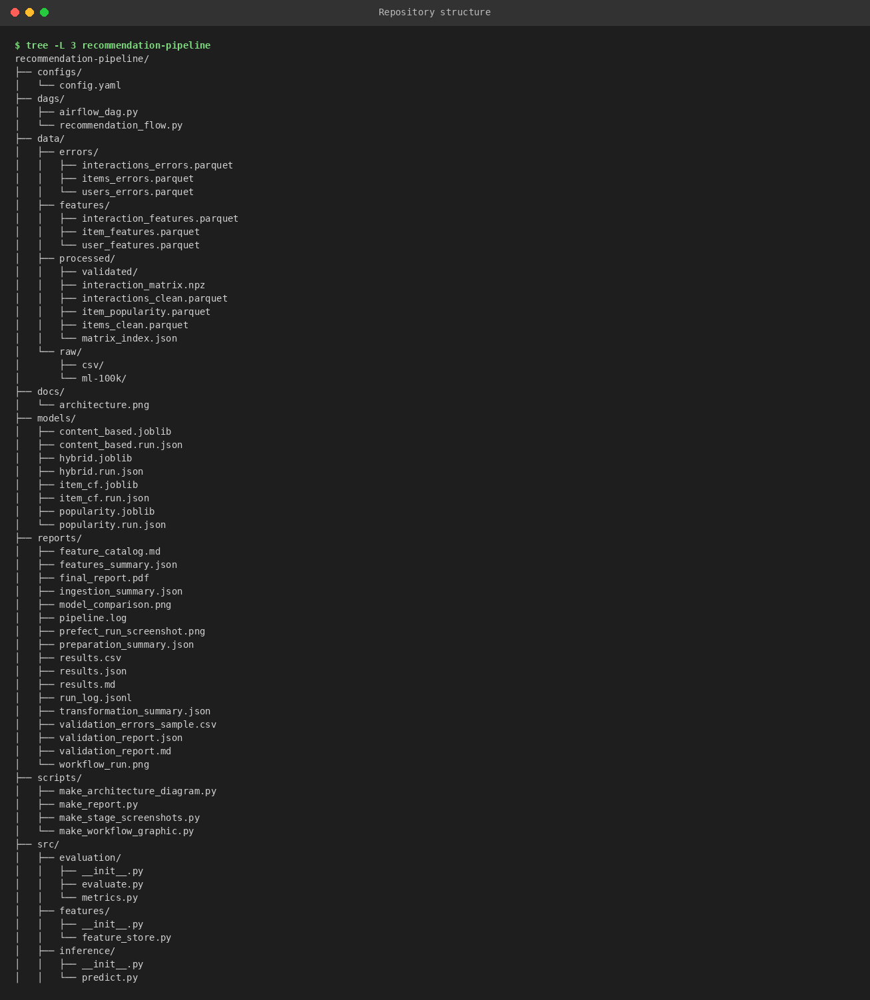

## 3. Stage-by-stage evidence

### 1. Ingestion

**What it does:** Loads users, items and interactions from MovieLens 100K and writes raw text CSVs. A seeded fault injection corrupts or appends 657 rows so the validator has real defects to find.

**Command:** `python run_pipeline.py --stage ingestion`

**Produces:** `data/raw/csv/*.csv`, `reports/ingestion_summary.json`

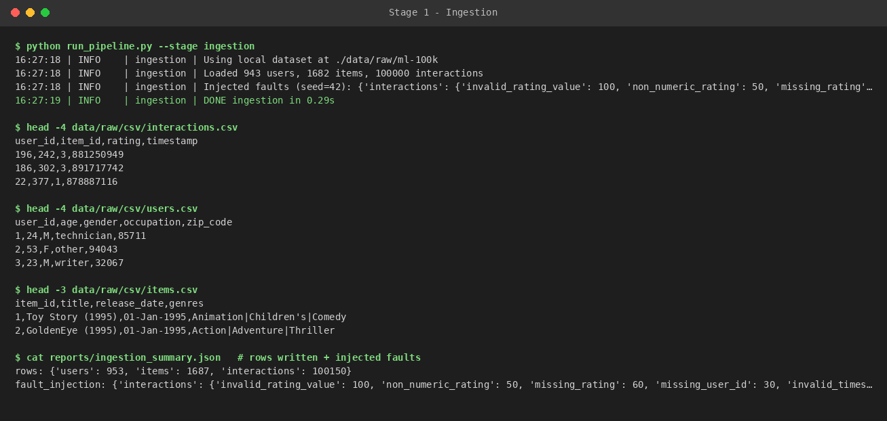

*953 users, 1,687 items and 100,150 interaction rows written.*

### 2. Data validation

**What it does:** Checks missing values, duplicates, data types, rating range, timestamp window and referential integrity. Unusable rows go to the error dataset with the reason; repairable attribute problems are warnings.

**Command:** `python run_pipeline.py --stage validation`

**Produces:** `data/errors/*.parquet`, `reports/validation_report.md`, `reports/validation_errors_sample.csv`

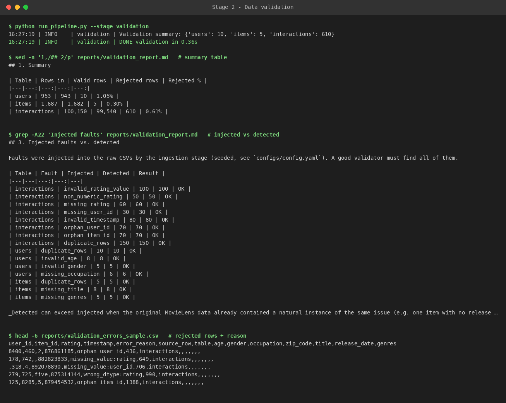

*Rejected: 610 interactions, 10 users, 5 items. Every injected fault was detected (see the injected-vs-detected table).*

### 3. Data preparation

**What it does:** Repairs warning-level issues (median imputation, standardised text), keeps the latest rating per (user, item) and creates the time-based train/test split.

**Command:** `python run_pipeline.py --stage preparation`

**Produces:** `data/processed/{users,items,interactions}_clean`, `train`, `test`

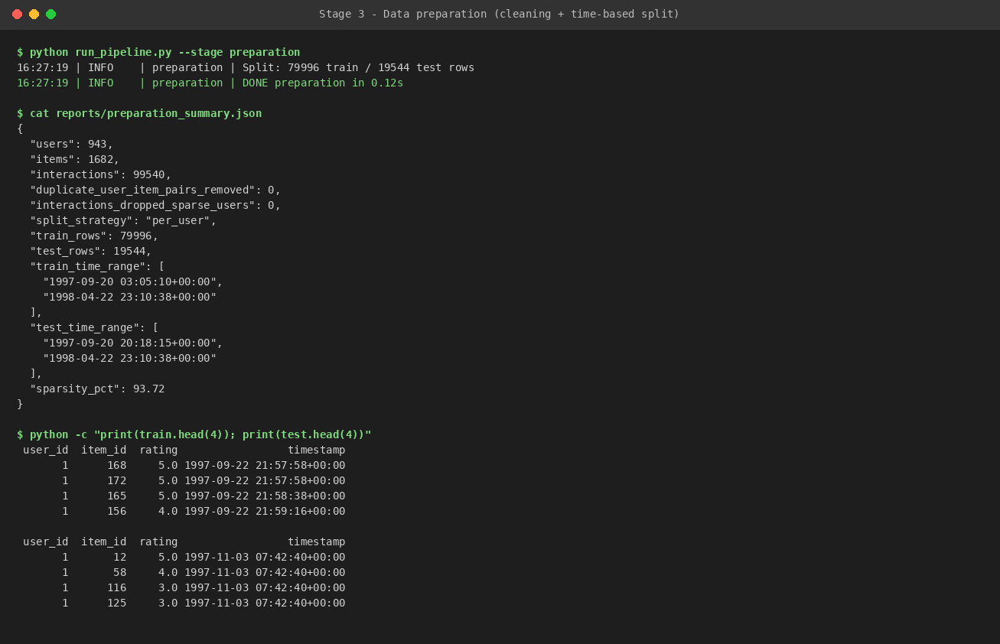

*Per-user chronological split: 79,996 train rows, 19,544 test rows.*

### 4. Data transformation

**What it does:** Builds derived datasets from the training split only: user activity summary, item popularity and the sparse user-item interaction matrix.

**Command:** `python run_pipeline.py --stage transformation`

**Produces:** `user_activity_summary`, `item_popularity`, `interaction_matrix.npz`

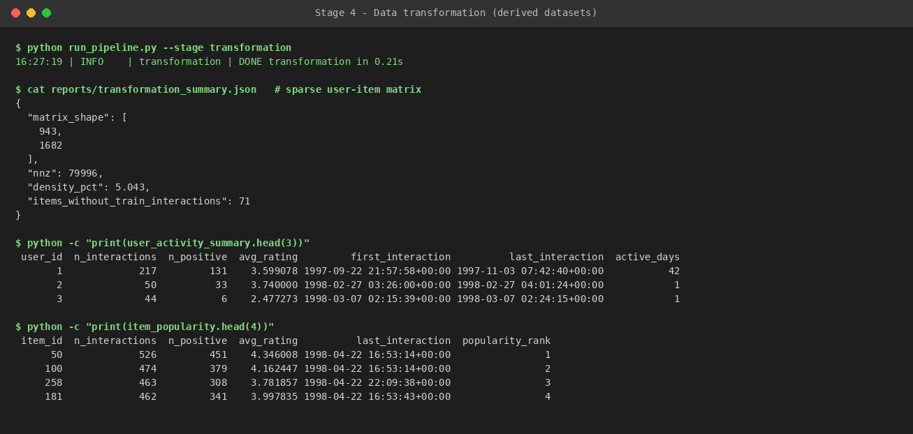

*Matrix shape 943 x 1682, 79,996 non-zero entries.*

### 5. Feature management

**What it does:** Computes documented user, item and interaction features point-in-time from the training data, stores them in a feature store and generates the feature catalog.

**Command:** `python run_pipeline.py --stage features`

**Produces:** `data/features/*.parquet`, `reports/feature_catalog.md`

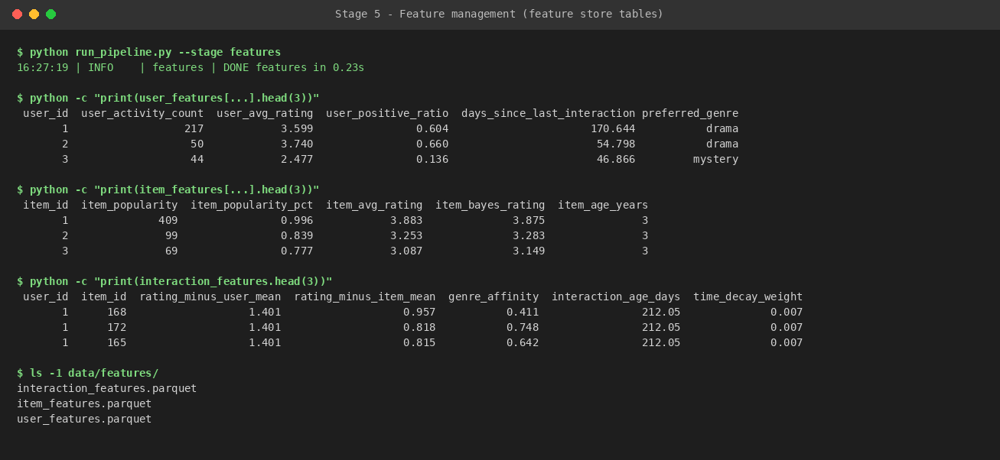

*The same compute functions are used for training and for prediction (`src/inference/predict.py`).*

### 6. Model training

**What it does:** Trains the popularity baseline and three personalised models (Item-CF, content-based, hybrid); parameters, timings and model artifacts are logged to MLflow.

**Command:** `python dags/recommendation_flow.py`

**Produces:** `models/*.joblib`, `models/*.run.json`, MLflow runs

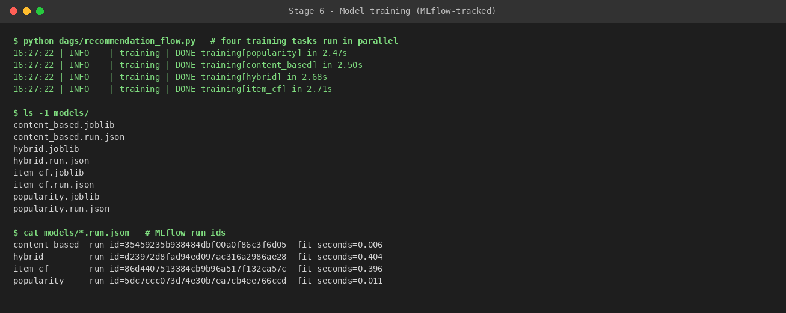

*The four training tasks run in parallel in the Prefect flow.*

### 7. Model evaluation

**What it does:** Evaluates every model at K = 10 (Precision, Recall, NDCG, Coverage, Diversity, plus RMSE / MAE) and logs the metrics to the same MLflow runs.

**Command:** `python run_pipeline.py --stage evaluation`

**Produces:** `reports/results.md`, `results.csv`, `model_comparison.png`

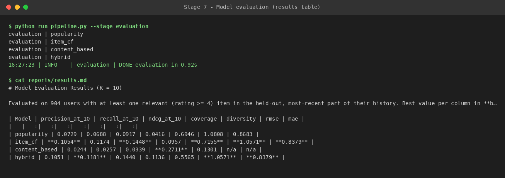

*Full analysis in `reports/model_comparison.md`.*

### 8. Unit tests

**Command:** `python -m pytest -q`

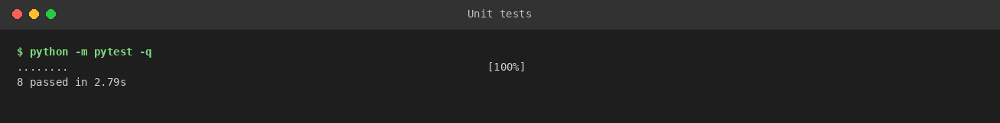

*Tests cover metrics, validation checks, the time-based split and the point-in-time rule for features.*

## 4. Orchestration evidence (Prefect)

The workflow runs ingest, validate, prepare, transform and features sequentially, then the four training tasks in parallel, then evaluation.

**Screenshot of a successful run (required deliverable)**

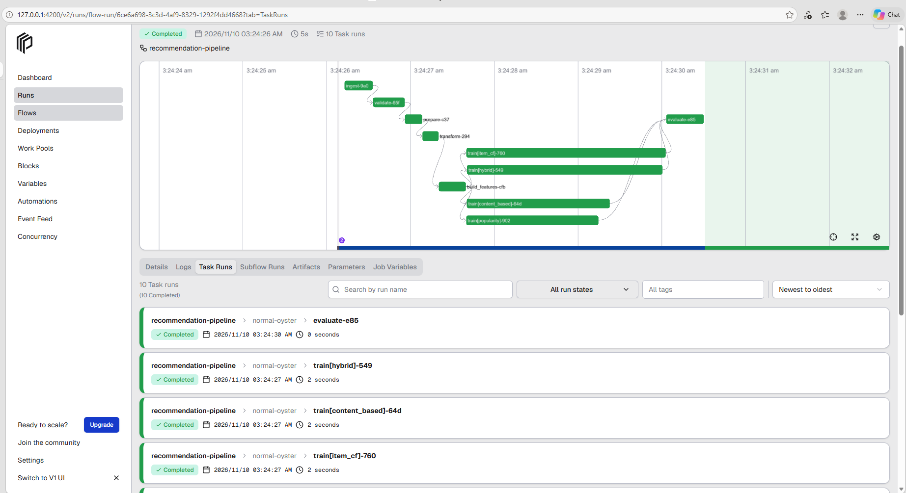

**Additional Prefect screenshots from the clean end-to-end run**

| Dashboard | Flow runs |
|---|---|
| 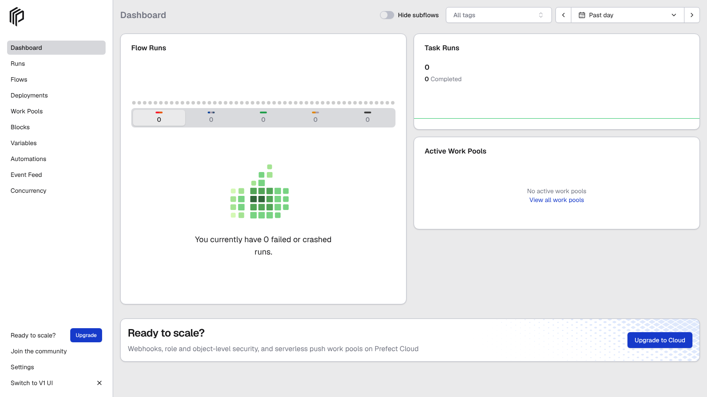 | 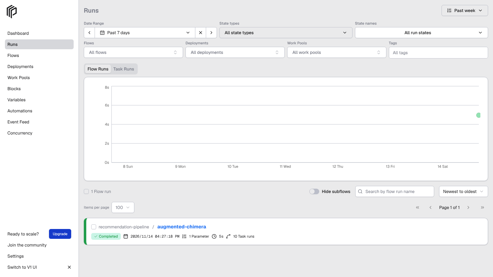 |

| Task graph and task runs | Flow-run logs |
|---|---|
| 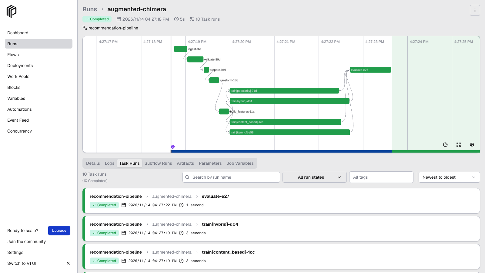 | 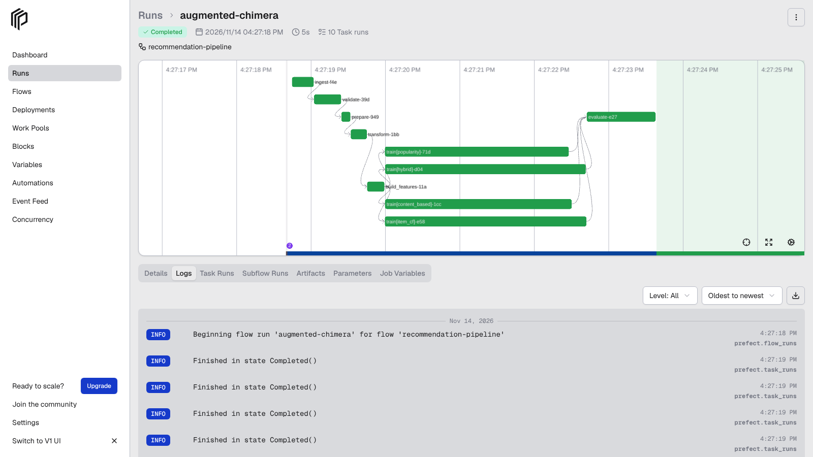 |

A summary graphic generated from `reports/run_log.jsonl` is in `reports/workflow_run.png`.

## 5. Experiment tracking evidence (MLflow)

One MLflow run per model in experiment `recsys-movielens-100k`.

| Experiments | Runs |
|---|---|
| 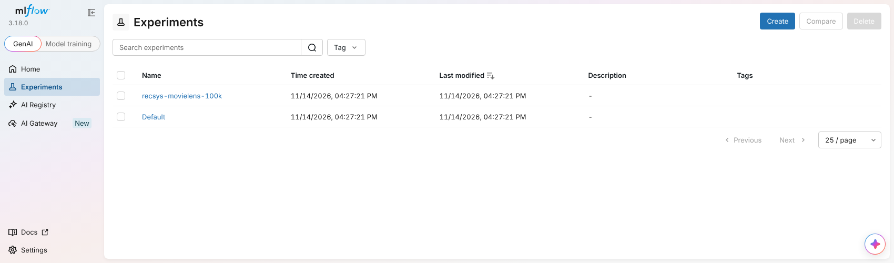 | 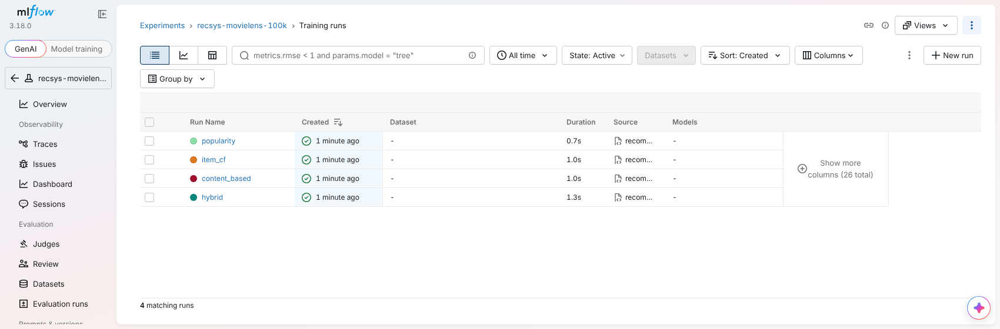 |

**Side-by-side comparison of the four runs (parameters and metrics)**

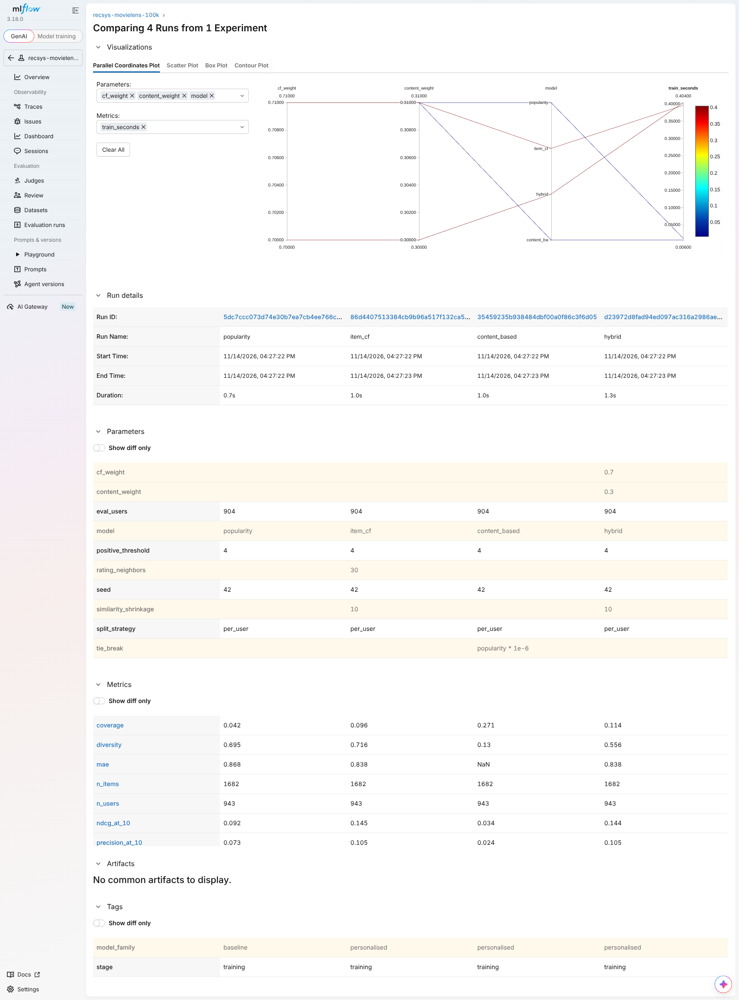

**One run in detail (parameters, metrics) and its stored model artifact**

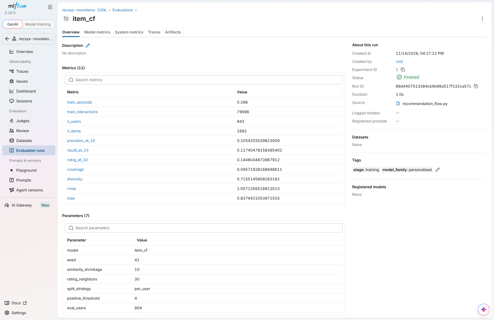

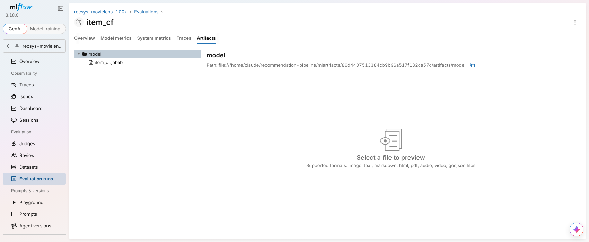
