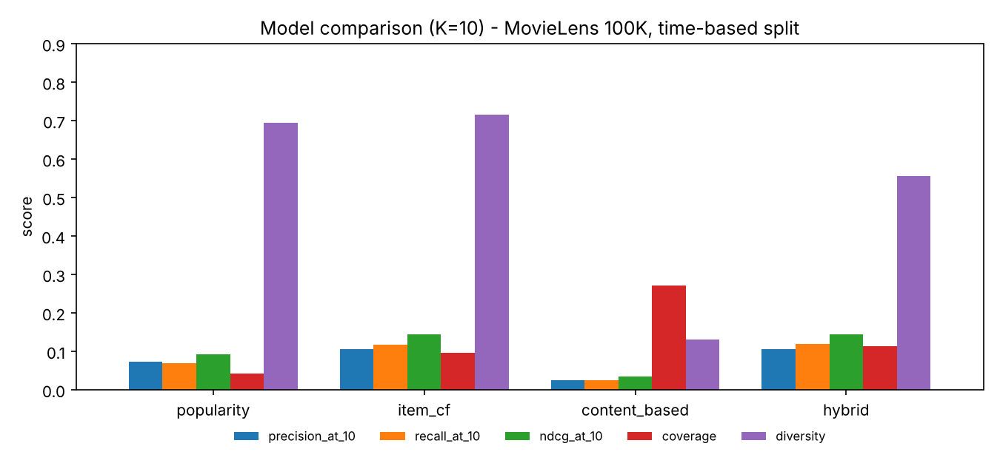

# Model Comparison

Comparison of the baseline and the personalised recommenders on the same data, split and metrics.
All numbers come from `reports/results.csv`, produced by the evaluation stage and logged to MLflow.

## Setup

| Item | Value |
|---|---|
| Dataset | MovieLens 100K (943 users, 1,682 items, 99,540 ratings after cleaning) |
| Split | Time-based, per user: the most recent 20% of every user's history is the test set (79,996 train / 19,544 test rows) |
| Relevant item | A test rating of 4 or more |
| Candidates | Every item the user did not rate in the training period |
| Cut-off | K = 10 |
| Users evaluated | 904 (users with at least one relevant test item) |
| Seed | 42 (fixed in `configs/config.yaml`) |

## Models

| Model | Type | How it works |
|---|---|---|
| Popularity | Baseline | Recommends the items most users liked; identical list for everyone (minus items already seen). |
| Item-CF | Collaborative filtering | Item-item cosine similarity on the liked matrix with significance shrinkage `co/(co+10)`; score = sum of similarities to the user's liked items. Rating head: adjusted-cosine k-NN. |
| Content-based | Content | Cosine between the user's genre-preference profile (user feature) and the item's genres (item feature). |
| Hybrid | Blend | 0.7 x Item-CF + 0.3 x content scores, each scaled to [0, 1] per user. Rating head from Item-CF. |

## Results

| Model | Precision@10 | Recall@10 | NDCG@10 | Coverage | Diversity | RMSE | MAE |
|---|---:|---:|---:|---:|---:|---:|---:|
| Popularity (baseline) | 0.0729 | 0.0688 | 0.0917 | 0.0416 | 0.6946 | 1.0808 | 0.8683 |
| Item-CF (personalised) | **0.1054** | 0.1174 | **0.1448** | 0.0957 | **0.7155** | **1.0571** | **0.8379** |
| Content-based (personalised) | 0.0244 | 0.0257 | 0.0339 | **0.2711** | 0.1301 | n/a | n/a |
| Hybrid CF + content (personalised) | 0.1051 | **0.1181** | 0.1440 | 0.1136 | 0.5565 | **1.0571** | **0.8379** |

Best value per column in **bold** (RMSE / MAE: lower is better; all others: higher is better).
RMSE / MAE are computed over all test ratings and only for models that predict ratings.

## Reading the results

* **Item-CF is the best ranker.** NDCG@10 0.145 vs 0.092 for the baseline (+58%), Precision@10 0.105 vs 0.073 (+45%), Recall@10 0.117 vs 0.069.
* **It also recommends more of the catalogue** (9.6% vs 4.2% coverage) with slightly more varied lists (diversity 0.716 vs 0.695), and predicts ratings better (RMSE 1.057 vs 1.081; MAE 0.838 vs 0.868). The rating gap is small because item averages are already a strong baseline.
* **Content-based is weak on accuracy** (Precision@10 0.024) because 19 coarse genres cannot separate items well, but it has the highest coverage (27.1%) because it is not dominated by popular titles; its diversity is low (0.130) since lists stay within a few genres.
* **The hybrid matches Item-CF on accuracy** (NDCG@10 0.144 vs 0.145) and raises coverage to 11.4%, but diversity drops to 0.556 because genre similarity pulls lists towards the user's favourite genres.
* **Caveat:** one dataset, one seed, no tuning, no significance tests - differences are indicative, not proven.

## Metric definitions

| Metric | Definition |
|---|---|
| Precision@K | Fraction of the K recommended items that are relevant, averaged over users. |
| Recall@K | Fraction of the user's relevant test items found in the top K, averaged over users. |
| NDCG@K | Discounted cumulative gain of the top K with binary relevance, normalised by the ideal ordering. |
| Coverage | Share of the item catalogue that appears in at least one user's top-K list. |
| Diversity | Mean pairwise genre dissimilarity (1 - cosine) of the items inside a list, averaged over users. |
| RMSE / MAE | Error of predicted vs true ratings over all test ratings (Popularity, Item-CF, Hybrid only). |

## Experiment tracking

Every model has an MLflow run in experiment `recsys-movielens-100k` holding parameters, training time, the metrics above and the model artifact.

| Model | MLflow run id |
|---|---|
| popularity | `5dc7ccc073d74e30b7ea7cb4ee766ccd` |
| item_cf | `86d4407513384cb9b96a517f132ca57c` |
| content_based | `35459235b938484dbf00a0f86c3f6d05` |
| hybrid | `d23972d8fad94ed097ac316a2986ae28` |

Screenshots: `screenshots/mlflow_02_runs_table.png`, `screenshots/mlflow_03_compare_runs.png`, `screenshots/mlflow_04_run_detail_item_cf.png`.
